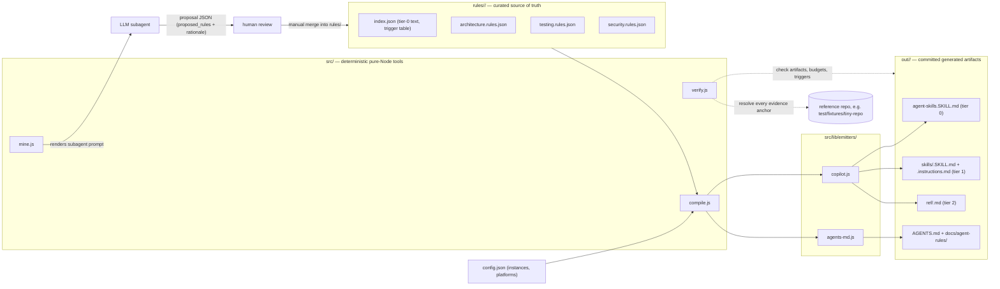
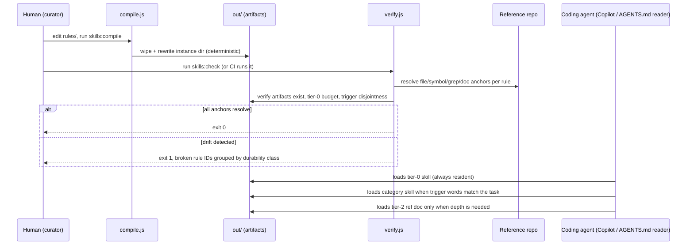
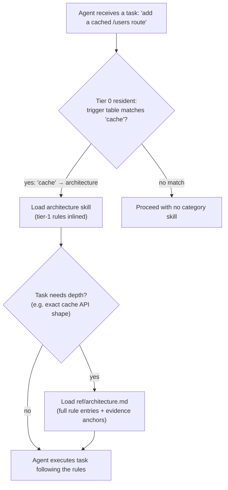

# Architecture

This document explains how agent-skills fits together: what data flows where, why the
design is shaped this way, and what each component is responsible for.

## Core design decision: inverted provenance

Most "agent instructions" projects let an LLM write the instructions. That makes the
instructions *outputs* — untestable, un-diffable against reality, and silently wrong the
moment the code changes.

agent-skills inverts this:

1. **The rule corpus is the source of truth.** It is curated data (JSON) that a human
   authors and reviews like code. Every rule carries *evidence anchors* pointing at
   concrete files/symbols/docs in a reference repository.
2. **The artifacts are derived.** A deterministic compiler renders the corpus into
   whatever shape each agent platform wants. Artifacts in `out/` are committed so skill
   changes appear as reviewable diffs, but they are never edited by hand.
3. **An LLM may *suggest* rules, never author them.** The mining pass (`mine.js`)
   renders a prompt for a subagent that scans a repo and returns candidate rules as a
   JSON proposal. A human merges what looks right into `rules/`.

## Data flow in one pass

The everyday loop is three commands:

Key properties:

- **Compile wipes then rewrites** the instance's out dir, so deleted categories never
  leave stale artifacts behind.
- **Verify is read-only** — it changes nothing; it just reports. It is safe to run in CI
  on every push.
- **Agents only ever read `out/`** (or copies of it). The corpus and tools are invisible
  to the agent at runtime.

## Tiered output design

The central ergonomics problem: agent context is expensive. A repo's full rule set can
run to hundreds of lines, but most tasks need only a handful of rules. So output is
tiered by *when it must be in context*:

| Tier | Artifact (Copilot) | Size budget | When it's loaded |
| --- | --- | --- | --- |
| 0 | `agent-skills.SKILL.md` | hard cap: 20 lines (enforced by verify.js) | Always resident |
| 1 | `skills/<category>.SKILL.md` + `.instructions.md` | ~30–60 lines per category | On trigger words or slash command |
| 2 | `ref/<category>.md` | unbounded | Explicitly, when a task needs depth |

Tier-0 holds the non-negotiable core disciplines plus a **trigger table** mapping word
patterns to categories (`cache` → architecture, `test|coverage` → testing, …). Tier-1
rules are inlined into their category skill body. Tier-2 rules live only in the ref doc;
their category skill contains a pointer ("read `ref/<category>.md` when doing X").

The AGENTS.md emitter expresses the same tiers as one `AGENTS.md` (tier 0 + table) plus
`docs/agent-rules/<category>.md` files referenced by relative path.

Note that the tier-2 ref doc is where evidence anchors appear in agent-facing form —
the file/symbol pointers let a skeptical agent (or a human reviewer) check that a rule's
claim still matches reality.

## Component responsibilities

| File | Responsibility | Must not |
| --- | --- | --- |
| `src/lib/rule-schema.js` | Define + validate the rule contract (`validateRule`, `validateCorpus`) | Read files, emit output |
| `src/lib/loaders.js` | Load `config.json` and corpus dirs into in-memory instances | Validate semantics beyond JSON shape |
| `src/lib/emitters/copilot.js` | Render Copilot artifacts (tier-0, category skills, instructions, ref docs) | Touch the filesystem |
| `src/lib/emitters/agents-md.js` | Render AGENTS.md + relative refs | Touch the filesystem |
| `src/compile.js` | CLI wiring: load → emit → write; determinism contract | Validate anchors (that's verify's job) |
| `src/verify.js` | CLI wiring: anchor resolution, drift reporting, artifact/budget checks | Modify anything |
| `src/mine.js` | Render the mining prompt; validate proposal documents | Write rules or touch the corpus |

Emitters are pure functions of (instance, category, rules) → string. That purity is what
makes snapshot/determinism testing cheap: the test suites call emitters and compare
bytes without any filesystem involvement.

## Determinism contract

`compile.js` guarantees byte-identical output for identical input:

- Categories are processed in sorted order; rules within a category are sorted by `id`.
- No timestamps, no absolute paths, no environment-dependent values appear in output.
- The instance out dir is wiped before writing (so the *set* of files is also
  deterministic).

Consequences: `git diff` on `out/` after a corpus edit shows exactly what changed in the
agent-facing instructions; CI can assert "compile is a no-op" as an invariant; and the
test suite can snapshot-compare.

## Extending the system

- **New platform**: add `src/lib/emitters/<name>.js` (pure renderers), register it in
  `compile.js`'s platform switch, add artifact checks to `verify.js`, list it in
  `config.json` → `platforms`.
- **New corpus instance**: create `rules/<name>/` (an `index.json` + one
  `<category>.rules.json` per category), point a `config.json` entry at its reference
  repo, run compile + check. Nothing else changes — categories are open-ended per
  instance.
- **New evidence kind**: extend the switch in `verify.js`'s `resolveAnchor` and the
  documentation/contract in `rule-schema.js`. All four current kinds (`file`, `symbol`,
  `grep`, `doc`) are exercised by the fixture corpus.
