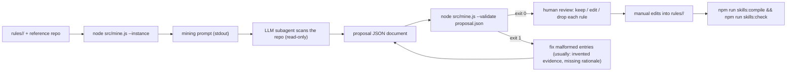

# `skills:mine` — LLM mining prompt renderer + proposal validator

```bash
npm run skills:mine            # = node src/mine.js
```

The mining pass is how a rule corpus *grows*: an LLM subagent scans a reference repo
and proposes new (or corrected) rules. `mine.js` owns two things, both deterministic and
side-effect free:

1. **Prompt rendering** — it prints the exact prompt to hand to a subagent (this chat
   session, Claude Code, Copilot agent mode, anything). The prompt is self-contained:
   it carries the repo path, the existing categories and rules (for dedup), the rule
   schema verbatim, and the required output shape.
2. **Proposal validation** — it checks a returned proposal document so obviously
   malformed candidates are rejected before a human ever reads them.

**`mine.js` never writes rules.** Its output is a JSON *diff proposal*; merging into
`rules/` is a deliberate human edit. This keeps the corpus curated-by-humans while still
offering LLM scale for discovery.

## Flags

| Flag | Default | Meaning |
| --- | --- | --- |
| `--config <path>` | `<root>/config.json` | Config file (to locate the instance) |
| `--instance <name>` | required unless exactly one instance is configured | Which corpus to render against / validate against |
| `--repo <path>` | repo path from config | Path string embedded in the rendered prompt (pass a relative or otherwise shareable path) |
| `--validate <proposal.json>` | — | Switches to validation mode: check a proposal document instead of rendering |

## Mode 1: render the prompt

```bash
node src/mine.js --instance tiny-repo --repo test/fixtures/tiny-repo > /tmp/mining-prompt.md
```

Pass the printed text verbatim to your subagent. The prompt contains, in order:

- **Task** — scan source *and* `docs/` read-only; prefer practice-level (durable) finds;
  propose a category taxonomy first, then rules; never re-propose existing coverage — if
  an existing rule is stale, propose `diff_target: "update:<rule-id>"` instead.
- **Existing categories** and **existing rules** (ids + instructions only — evidence is
  deliberately omitted to keep the prompt small) for deduplication.
- **The rule schema contract, verbatim** — every field, all four evidence kinds, both
  durability values. The miner's output is machine-checkable precisely because the
  prompt and `src/lib/rule-schema.js` describe the same contract.
- **Output shape** — a single JSON document, no prose:

  ```jsonc
  {
    "suggested_categories": ["..."],          // taxonomy first (may be empty if none new)
    "proposed_rules": [
      {
        "id": "arch-...", "tier": 1, "category": "...", "instruction": "...",
        "triggers": ["..."], "evidence": [{ "kind": "file", "ref": "..." }],
        "durability": "durable", "status": "active",
        "rationale": "why this matters + what was observed",   // required, mining-only
        "diff_target": "new"                                    // or "update:<existing-id>"
      }
    ]
  }
  ```

- **Constraints** — evidence anchors must be things the miner actually observed (the
  verifier will reject invented paths/symbols); keep trigger words disjoint; prefer tier 1
  for short frequently-relevant rules and tier 2 for depth; an empty `proposed_rules`
  array is a valid answer when the repo doesn't justify more rules.

Rendering is deterministic: same instance + repo path → identical bytes, so prompts can
be diffed across corpus versions in code review.

## Mode 2: validate a proposal

```bash
node src/mine.js --validate /tmp/proposal.json --instance tiny-repo
```

Per proposed rule it runs the full `validateRule` (same contract as the curated corpus)
plus mining-specific checks:

- `rationale` present and non-empty;
- `diff_target` is `"new"` or `"update:<id>"` where `<id>` exists in the current corpus
  (unknown targets are flagged — this catches stale proposals);
- `category` is either an existing category or listed in `suggested_categories`;
- duplicate IDs *within* the proposal are flagged.

Output: one line per rule (`mine: OK <id> (<diff_target>)` or a bulleted problem list),
plus document-level problems. **Exit 1** if anything is malformed, **0** if the whole
proposal is clean.

## The intended workflow



Notes for the human review step:

- **Trust but verify evidence.** Even a validated proposal's anchors are only checked
  for *shape* here — after merging, `skills:check` resolves them against the repo. A
  miner that hallucinated a path will pass validation and fail check; that is the
  intended safety net.
- **Prefer durable over volatile finds**, and mark genuinely implementation-specific
  findings `volatile`.
- New categories from `suggested_categories` need an `index.json` update (declare the
  category + trigger words) before their rules will pass corpus validation.
