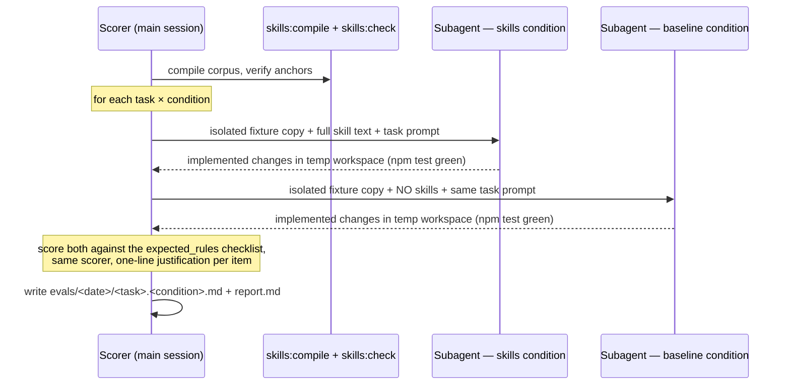

# Golden-task conformance evals (Phase E)

This document explains the behavioral evaluation suite in `evals/`: what it measures,
**what actually generated the recorded eval runs**, what you need to reproduce a run,
and how results are scored. The normative protocol is [evals/PROTOCOL.md](../evals/PROTOCOL.md);
this page is the longer-form explanation for someone meeting the suite for the first time.

## What it measures

A rule corpus can be *structurally* sound (compiles, anchors resolve) and still be
useless to an agent — or worse, actively misleading. The conformance eval measures the
behavioral question:

> If a coding agent is given **only** the generated skills as standing instructions and
> asked a realistic task against the reference repo, does its output follow the corpus?

And, critically, the counterfactual:

> How much better is that than the same agent with **no skills at all** (the baseline /
> negative control)?

The number that matters is the delta: **conformance(skills) − conformance(baseline)**.
That delta *is* the measured value of the skill set. A rule that scores *lower* under
skills than under baseline is flagged as wrong, noisy, or misleading — and gets fixed or
dropped, never silently kept.

## What generated the evals in `evals/2026-09-16/`

Honesty about provenance matters here, because "the score went up" means nothing unless
you know who produced it:

- **The tasks** (`evals/tasks/<category>/*.json`) were **authored by hand** against the
  `tiny-repo` fixture corpus — a realistic prompt plus an `expected_rules` checklist of
  rule IDs, each with per-item descriptions of what "satisfied" looks like. They are data,
  versioned like everything else in the repo.
- **The agent runs were performed by LLM subagents** (coding-agent sessions launched from
  this repository's chat session), not by a script. For each task × condition, a fresh
  subagent was given an isolated copy of the fixture and told to implement the task:
  - **skills condition**: the full text of every generated skill file
    (`out/tiny-repo/copilot/agent-skills.SKILL.md` + all `skills/*.SKILL.md`) presented
    as standing instructions, plus the task prompt.
  - **baseline condition**: no skill content at all — just "you are working in this
    Node.js repository" plus the task prompt.
- **Scoring was done manually by the main session** (the same scorer for both conditions,
  to keep judgments consistent): inspect the changed files in each temp workspace, mark
  each checklist item satisfied/not with a one-line justification.

So: tasks = human-authored data; execution = LLM subagents; scoring = human judgment.
There is currently **no automated scoring script** — that is a listed follow-up
(see below). The first run (2026-09-16) covered 3 tasks × 2 conditions and found
100% vs 100% (Δ 0) — interpreted honestly in the report as "the fixture is too
self-documenting for these positive-pattern tasks", not as "skills are worthless".

## Repository layout

```
evals/
  PROTOCOL.md                    # the normative protocol (inputs, procedure, scoring, records)
  tasks/
    manifest.json                # instance metadata for the suite
    architecture/
      add-users-route.json       # { id, category, prompt, expected_rules: [{rule_id, checklist}] }
      handle-upstream-failure.json
      refresh-cache-ttl.json
    testing/
      new-module-tests.json
      errors-golden-snapshot.json
    security/
      render-user-name.json
      new-html-page.json
      json-route-headers.json
  <YYYY-MM-DD>/                  # one dir per run, committed
    <task-id>.<condition>.md     # per-item scoring with justifications
    report.md                    # summary table, conformance %, delta, flagged rules
```

Task JSON shape:

```jsonc
{
  "id": "arch-add-users-route",
  "category": "architecture",
  "prompt": "Add a GET /users route that lists users from the cache…",
  "expected_rules": [
    { "rule_id": "arch-route-registration", "checklist": ["route registered in the server's route table", "..."] },
    { "rule_id": "arch-fetch-through-cache", "checklist": ["data fetched via CacheStore.getOrFetch, no ad-hoc fetch"] }
  ]
}
```

## Prerequisites for a run

1. **Node ≥ 18.3** (the fixture's own test script relies on modern `node --test` behavior;
   the corpus was developed on Node 24).
2. **A compiled, current skill set.** Run `npm run skills:compile` first — the skills
   under test must match the corpus byte-for-byte. Then `npm run skills:check` to confirm
   the anchors are live. Scoring against stale artifacts measures nothing.
3. **The fixture repo in a clean state** (`test/fixtures/tiny-repo/`, green `npm test`
   inside it). Each run copies it to an isolated temp workspace (`.tmp-eval/<condition>/<task-id>/repo`,
   gitignored); the fixture itself is never modified by a run.
4. **A subagent-capable session** (any coding agent that can be given standing
   instructions + a task prompt + a repo path and left to work). The protocol is
   agent-agnostic; the first runs used this repository's chat subagents.
5. **One human scorer** who knows both the task checklists and the corpus, applying the
   same judgment standard to both conditions.

## Run procedure (condensed from PROTOCOL.md)



## Scoring

- **Per task**: `satisfied / total` over all checklist items in its `expected_rules`.
- **Conformance % per condition**: average across all tasks in the run.
- **Value of skills** = conformance(skills) − conformance(baseline).
- **Flag rules**: any rule with *lower* coverage under skills than baseline is called out
  in `report.md` with a fix-or-drop recommendation. This is the mechanism that keeps the
  corpus honest — evals are not just a vanity metric, they're a defect detector for rules.

## Reading the first run (2026-09-16)

See [`evals/2026-09-16/report.md`](../evals/2026-09-16/report.md). Summary: 3 tasks
(one per category), 100% both conditions, Δ 0. The report's interpretation is the point
to internalize:

- A zero delta on *positive-pattern* tasks against a tiny, self-documenting fixture is
  **expected** — "follow existing conventions" is enough when `items.js` already
  demonstrates the exact pattern.
- The skills-vs-baseline delta is expected to be non-zero where the corpus encodes
  something **not inferable from the code**: negative constraints ("never add npm deps"),
  upcoming changes (volatile rules), cross-cutting invariants.

## Follow-ups (status as of 2026-09-16)

1. **Harder, rule-dependent tasks** — e.g. "add express to speed up routing" (expect the
   agent to *refuse* per the zero-dependency discipline); these are where Δ should go
   non-zero. Not yet authored.
2. **Scale to 4–6 tasks per category** (plan step 11). Currently 3/2/3 tasks are defined;
   only one per category was executed in the first run.
3. **Automated scoring script** — so runs are reproducible without manual checklist
   review. Not yet written.

## Why this protocol (and not "just ask the LLM to grade itself")

- The **negative control** is what makes the measurement meaningful: it separates
  "the agent did a good job" from "the skills caused the good job".
- **Same scorer, both conditions** keeps judgment bias from inflating or deflating the
  delta.
- **Records are committed** (scores + justifications), temp workspaces are not — an eval
  run is an auditable artifact of the repo's history, so future corpus changes can be
  compared against past numbers.
